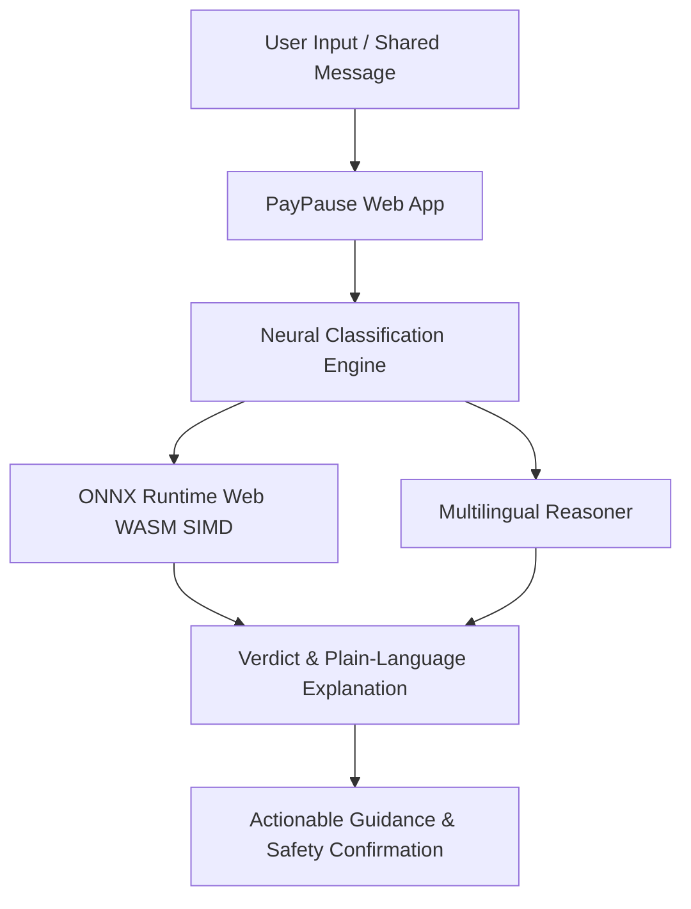

# <p align="center">🛡️ PayPause</p>

<p align="center">
  <strong>The pause before you pay. Instant on-device scam & digital fraud intelligence.</strong>
</p>

<p align="center">
  
  
  
  
  
  
</p>

---

## 📖 Overview

**PayPause** is a privacy-first web application engineered to protect digital payment users from financial fraud, phishing links, and social engineering attacks before money leaves their accounts. 

Whether it's a suspicious WhatsApp forward, a fake KYC SMS, a refund QR code, or an urgent OTP request, PayPause analyzes the intent and delivers a plain-language verdict in under a second — directly on your device.

---

## ✨ Key Features

- ⚡ **Real-Time Fraud Detection**: Instant evaluation of suspicious SMS, WhatsApp forwards, payment links, and UPI messages.
- 🧠 **On-Device Neural Engine**: Powered by quantized ONNX models running directly in the browser via WebAssembly SIMD (`0 bytes` of message data sent to external servers).
- 📷 **Intelligent QR Intent Decoder**: Decodes `upi://` payment strings to distinguish incoming collect requests from fraudulent outgoing debits before you scan.
- 🌐 **Multilingual Plain Language**: Seamless English and Hindi (हिन्दी) verdict explanations designed for everyone, with zero financial jargon.
- 🎨 **Cinematic Parallax Storytelling**: High-performance requestAnimationFrame scroll engine blending architectural landscape layers with glassmorphic UI.
- 📱 **Progressive Web App (PWA)**: Installable on Android, iOS, and Desktop with offline caching and Web Share Target support.

---

## 🎯 Scam Patterns Analyzed

| Vector | Description | Detection Capability |
| :--- | :--- | :---: |
| 🔄 **Fake Refund QR** | Scammer instructs user to scan a QR code to "receive money", initiating an outgoing debit. | ✅ |
| 📑 **KYC Phishing** | Fake bank/SIM block threats urging users to click malicious phishing forms. | ✅ |
| 🔑 **OTP Social Engineering** | Callers or messages impersonating bank officials to obtain authorization codes. | ✅ |
| 📸 **Fake Payment Screenshots** | Fabricated transaction screenshots used to pressure merchants into releasing goods. | ✅ |
| ☎️ **Customer Care Impersonation** | Fake toll-free helpline numbers designed to extract credentials and PINs. | ✅ |
| 🎁 **Lottery & Prize Scams** | Unsolicited messages promising high-value rewards to harvest financial credentials. | ✅ |

---

## 🏗️ Architecture



---

## 🛠️ Tech Stack

- **Frontend**: React 18, TypeScript, Vite 5
- **Styling**: Vanilla CSS (Custom Design System, Glassmorphism, Dark Mode)
- **ML & Inference**: ONNX Runtime Web, WebAssembly SIMD, Google Gemini Flash API
- **Internationalization**: `i18next`, `react-i18next` (English & Hindi)
- **QR Engine**: `@zxing/browser`
- **PWA & Offline**: `vite-plugin-pwa`, Workbox Service Workers
- **Deployment**: Vercel

---

## 🚀 Getting Started

### Prerequisites
- Node.js (v18.0 or higher)
- npm or yarn

### 1. Clone & Install Dependencies
```bash
git clone https://github.com/your-username/PayPause.git
cd PayPause
npm install
```

### 2. Configure Environment Variables
Create a `.env` file in the root directory:
```env
VITE_GEMINI_API_KEY=your_gemini_api_key_here
```

### 3. Run Locally
```bash
npm run dev
```
Open [http://localhost:5173](http://localhost:5173) in your browser.

### 4. Build for Production
```bash
npm run build
```

---

## ☁️ Deployment on Vercel

1. Push your repository to GitHub.
2. Import the repository into **[Vercel](https://vercel.com)**.
3. In **Project Settings $\rightarrow$ Environment Variables**, add:
   - **Key**: `VITE_GEMINI_API_KEY`
   - **Value**: `your_api_key`
4. Click **Deploy**.

---

## 🔒 Privacy & Security

- **Zero-Server Data Transmission**: Message text analyzed via local neural inference never leaves the client browser.
- **No Sign-Up / No Account Required**: Completely frictionless access without tracking personal identities.
- **Client-Side Processing**: QR decoding, heuristic pattern matching, and rule checks run entirely in the browser sandboxed environment.

---

## 📄 License

This project is licensed under the MIT License — see the [LICENSE](LICENSE) file for details.
